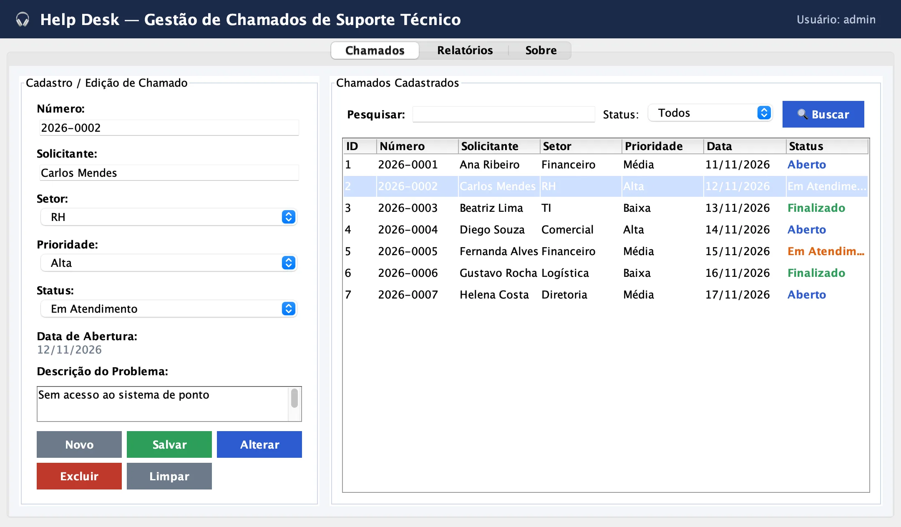
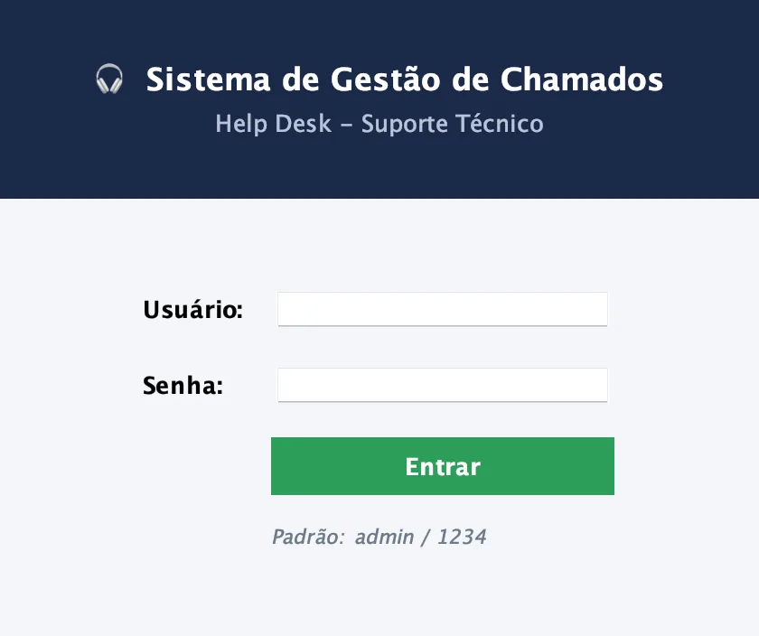
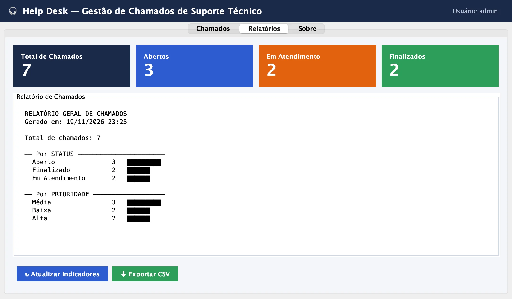
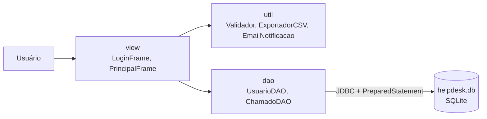
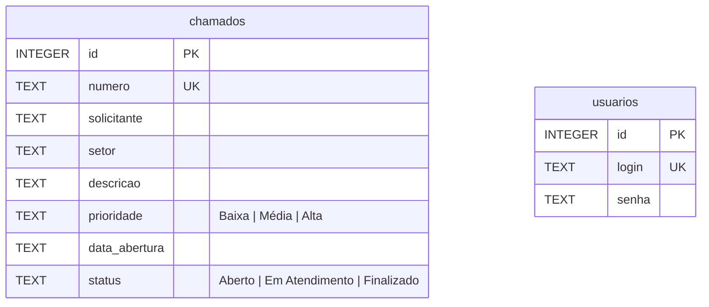

# Helpdesk Java

Sistema desktop de chamados de suporte em Java Swing com SQLite via JDBC, mais o exercício de conexão JDBC que veio antes dele. Projetos da disciplina de Análise e Projeto de Sistemas (Análise e Desenvolvimento de Sistemas, Faculdade Senac PR).



## Projetos

| Pasta | O que é |
|---|---|
| [`helpdesk-system/`](./helpdesk-system) | Projeto Final Integrador: help desk com login, CRUD de chamados, filtros, relatórios, exportação CSV. Tem README próprio com o mapa requisito → código. |
| [`helpdesk-sistema/`](./helpdesk-sistema) | Cópia do mesmo código-fonte (versão entregue, com o `RELATORIO.md` na raiz). |
| [`jdbc-sqlite-example/`](./jdbc-sqlite-example) | Primeiro teste JDBC: abre `produtos.db` e imprime `Conectado!`. |
| [`jdbc-sqlite-crud/`](./jdbc-sqlite-crud) | Mesmo `Main.java` do exemplo acima, com o relatório da atividade. |

## Help desk

| Login | Relatórios |
|---|---|
|  |  |

Capturas da aplicação rodando localmente com chamados fictícios.

- Login contra a tabela `usuarios` (usuário padrão criado na primeira execução: `admin` / `1234`).
- Cadastro, edição e exclusão de chamados, com número sugerido (`CH-AAAA-NNN`) e data de abertura automática.
- Busca por número, solicitante ou descrição, com filtro por status.
- Aba de relatórios: indicadores por status, contagem por status e prioridade, exportação CSV.
- Regras em `Validador`: campos obrigatórios, número único, prioridade e status de listas fixas, chamado finalizado não pode ser excluído.
- Ao finalizar um chamado, uma "notificação por e-mail" é simulada no console (`EmailNotificacao`).

### Como funciona





As tabelas são criadas por `ConexaoSQLite.inicializarBanco()` no arquivo `helpdesk.db`, na pasta de onde o programa é executado. A senha fica em texto puro: é um projeto acadêmico.

## Como rodar

Pré-requisito: JDK 17+ (o código usa text blocks).

Os scripts esperam os jars em `lib/`, mas o `.gitignore` ignora `*.jar`, então a pasta não vem no clone. Baixe os jars do Maven Central antes da primeira execução:

```bash
cd helpdesk-system            # ou jdbc-sqlite-example / jdbc-sqlite-crud
mkdir -p lib && M=https://repo1.maven.org/maven2
curl -fLo lib/sqlite-jdbc.jar $M/org/xerial/sqlite-jdbc/3.46.1.3/sqlite-jdbc-3.46.1.3.jar
curl -fLo lib/slf4j-api.jar   $M/org/slf4j/slf4j-api/2.0.16/slf4j-api-2.0.16.jar
curl -fLo lib/slf4j-nop.jar   $M/org/slf4j/slf4j-nop/2.0.16/slf4j-nop-2.0.16.jar

bash run.sh                   # Windows: run.bat (só no helpdesk)
```

O `run.sh` compila para `out/` e abre a tela de login. No JDK 24+ o driver SQLite mostra um aviso de "restricted method"; ele não impede a execução.

## Estrutura

```text
helpdesk-system/
├── run.sh / run.bat
├── docs/RELATORIO.md            # relatório entregue
└── src/helpdesk/
    ├── Main.java                # look and feel, cria o banco, abre o login
    ├── model/                   # Chamado, Usuario
    ├── dao/                     # ConexaoSQLite, ChamadoDAO, UsuarioDAO
    ├── util/                    # Validador, ExportadorCSV, EmailNotificacao
    └── view/                    # LoginFrame, PrincipalFrame, UITheme
docs/media/                      # capturas usadas neste README
```

Não há testes automatizados.

## Licença

MIT © [Pedro Szpak](https://github.com/PeSzpak)
